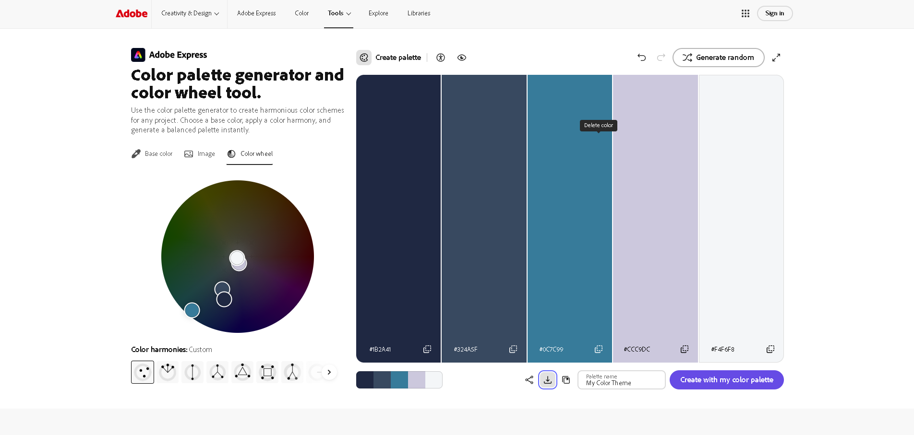

# INFR3120 Assignment 1 - Portfolio Site
Live site: 
Repository: 

## Pages
index.html (Home), about.html (About Me), projects.html (Projects), contact.html (Contact Me). Four separate files, not a single-page app.

## Responsive design (fluid design + media queries, no Flexbox)
Widths use percentages and images use `max-width: 100%`. Layout uses `float` plus a clearfix. Each viewport has its own CSS file:

| File | Applies at | Why |
|---|---|---|
| css/mobile.css | up to 767px (base) | Phones are about 360-430px wide, so one column |
| css/tablet.css | 768px and up | Portrait iPad width; 4 nav links in a row, 2 projects per row |
| css/laptop.css | 1024px and up | Smallest common laptop; content capped at 1100px, 3 projects per row |

## Gradients
- `.hero` banner on Home: angled `linear-gradient(135deg, ...)` in mobile.css, and a 3-colour `45deg` version in laptop.css
- Submit button on Contact page: `linear-gradient(to bottom, ...)` in mobile.css

## Colour scheme (Adobe Color)
Navy #1B2A41, Slate #324A5F, Teal #0C7C99, Sky #CCC9DC, Light #F4F6F8. ()

## Form validation
HTML5 attributes: `required`, `type="email"`, phone `pattern="[0-9]{10}"`, name `pattern`, message `minlength`/`maxlength`, and a 2+2 question.

## External code / citations
(List anything you copied with source and author. Keep it under 10%.) None so far.

## Testing
HTML (W3C Validator), CSS (Jigsaw), links (W3C Link Checker), spelling, WAVE accessibility: 
